<p align="center">
  
</p>

# 🎨 Awesome UI Styling & Design Frameworks 🚀

<p align="center">
  <strong>The definitive, curated index of UI styling engines, CSS frameworks, component design systems, and headless accessibility primitives for modern web engineering.</strong>
</p>

<p align="center">
  <a href="https://github.com/ishandutta2007/Awesome-Awesome-Awesome"></a>
  <a href="https://discord.gg/jc4xtF58Ve"></a>
  <a href="https://github.com/ishandutta2007/Awesome-UI-Styling-Design-Framework/stargazers"></a>
  <a href="https://github.com/ishandutta2007/Awesome-UI-Styling-Design-Framework/network/members"></a>
  <a href="https://github.com/ishandutta2007/Awesome-UI-Styling-Design-Framework/pulls"></a>
  <a href="https://github.com/ishandutta2007/Awesome-UI-Styling-Design-Framework/blob/main/LICENSE"></a>
  <a href="https://github.com/ishandutta2007"></a>
</p>

---

## 📑 Table of Contents

- [🌐 Overview & Architecture Paradigm](#-overview--architecture-paradigm)
- [📊 Sector Overview & Market Dynamics](#-sector-overview--market-dynamics)
- [💼 Commercial & SaaS UI Framework Platforms](#-commercial--saas-ui-framework-platforms)
- [🌟 Top Open-Source UI Styling & Design Frameworks](#-top-open-source-ui-styling--design-frameworks)
- [🧭 Architectural Taxonomy: Choosing Your Stack](#-architectural-taxonomy-choosing-your-stack)
- [🛠️ How to Contribute](#️-how-to-contribute)
- [⭐ Star History](#-star-history)
- [💖 Support & Community](#-support--community)
- [⚖️ Disclaimer & License](#️-disclaimer--license)

---

## 🌐 Overview & Architecture Paradigm

Building resilient, accessible, and high-velocity frontend interfaces requires choosing the right balance between **speed-to-prototype**, **runtime overhead**, **design token governance**, and **code ownership**. Modern frontend development has bifurcated into four key layers:

1. ⚡ **Utility-First Engines**: Compiles atomic, low-level CSS utility classes directly at build-time (e.g., Tailwind CSS, UnoCSS).
2. 🧩 **Headless Accessibility Primitives**: Unstyled UI components that solve ARIA specifications, focus management, and keyboard navigation while giving you 100% control of the styling layer (e.g., Radix UI, Base UI, React Aria, Headless UI).
3. 📦 **Copy-Paste & Code-Ownership Systems**: Reusable, pre-styled components copied straight into your repository so you own the source code without upstream package lock-in (e.g., shadcn/ui).
4. 🎨 **Batteries-Included Component Suites**: Full-spectrum, pre-themed component kits with rich out-of-the-box widgets and enterprise data controls (e.g., Bootstrap, Material UI, Ant Design, Mantine).

---

## 📊 Sector Overview & Market Dynamics

The global **Frontend Web Development Tools & UI Framework Market** is valued at approximately **$9.2 Billion in 2025** and is projected to reach **$23.7 Billion by 2032**, expanding at a robust **CAGR of 14.5%**. This rapid expansion is propelled by enterprise design system consolidation, multi-platform design token synchronization (Figma-to-code), and increasing regulatory mandates for WCAG 2.1/2.2 accessibility compliance across software touchpoints.

In terms of competitive structure, the market is **moderately fragmented and hybrid-stratified** rather than a winner-take-all ecosystem. While utility-first styling has strongly consolidated around Tailwind CSS and legacy enterprise footprints remain anchored in Bootstrap and Google Material Design, the component and design token management layers remain highly diverse. Frontline engineering teams increasingly build composite stacks—uniting utility engines, headless behavioral primitives, and centralized design token management SaaS platforms rather than relying on a single monolithic provider.

---

## 💼 Commercial & SaaS UI Framework Platforms

The following table evaluates top commercial SaaS platforms, enterprise UI component suites, and design system management vendors. Entries are ranked by **Company Scale (Valuation / Revenue)** in descending order:

| 🏢 Platform / Vendor | 📈 Company Scale (Valuation / ARR) | 💵 Starting Tier Pricing | 🎁 Free Tier Limit / Trial Duration | 🎯 Key Focus & Target Use Case |
| :--- | :--- | :--- | :--- | :--- |
| **[Adobe Spectrum](https://spectrum.adobe.com/)** <br>*(Adobe Inc. - NASDAQ: ADBE)* | **~$160B Market Cap** <br>(~$21.5B Revenue) | **$37.99 / user / month** <br>(Creative Cloud Single App; $89.99/user/mo for All Apps) | **Free Forever** for open-source Spectrum CSS & Web Components (Apache 2.0); **7-day free trial** for Creative Cloud enterprise token sync | Enterprise-grade, multi-platform design language; optimal for teams developing Adobe-adjacent applications or reference enterprise design systems. |
| **[Kendo UI](https://www.telerik.com/kendo-ui)** <br>*(Progress Software - NASDAQ: PRGS)* | **~$2.5B Market Cap** <br>(~$750M Revenue) | **$1,149 / dev / year** <br>(Priority Support license for React, Angular, Vue, or jQuery) | **30-day fully functional free trial** with unrestricted component usage and enterprise technical support | Mission-critical enterprise applications requiring high-density data grids, schedulers, charts, and financial UI controls. |
| **[Syncfusion Essential Studio](https://www.syncfusion.com/essential-studio)** <br>*(Syncfusion, Inc.)* | **~$80M - $100M ARR** <br>(Bootstrapped / Private) | **$995 / dev / year** <br>(Full studio license; or $395/platform/year) | **Free Forever Community License** for individual developers and organizations with ≤5 developers and &lt;$1M USD gross revenue; **30-day free trial** for Enterprise | Vast collection of 1,800+ enterprise UI components across React, Angular, Vue, Blazor, Flutter, and ASP.NET. |
| **[Infragistics Ignite UI](https://www.infragistics.com/products/ignite-ui)** <br>*(Infragistics, Inc.)* | **~$50M - $60M ARR** <br>(Private) | **$1,080 / dev / year** <br>(Ignite UI suite; $1,295/dev/year for Infragistics Ultimate) | **30-day free trial** including complete access to all controls, the App Builder WYSIWYG platform, and technical support | High-frequency financial trading desks, healthcare dashboards, and low-code design-to-code enterprise applications. |
| **[Zeroheight](https://zeroheight.com/)** <br>*(Zeroheight Ltd.)* | **~$45M Valuation** <br>(Raised $10M Series A) | **$49 / month** <br>(Starter tier; $39/mo billed annually) | **Free Forever plan** includes 1 styleguide, 1 editor seat, unlimited viewers, and up to 10 releases | Collaborative documentation SaaS unifying Figma design tokens with live code snippets (React, Vue, Web Components). |
| **[MUI SAS / MUI X](https://mui.com/pricing/)** <br>*(MUI SAS)* | **~$35M Valuation** <br>(Backed by OSS Capital / YC; ~$5M+ ARR) | **$15 / dev / month** <br>($180/dev/year billed annually for MUI X Pro; $37/dev/mo for Premium) | **Free Forever Community tier** (MUI Core + basic Data Grid up to 100 rows under MIT); **30-day free trial** for Pro/Premium | Advanced React data tables, virtualization grids, date-time pickers, and charts built atop Google's Material Design. |
| **[Knapsack](https://www.knapsack.map/)** <br>*(Knapsack Inc.)* | **~$30M Valuation** <br>(Raised $8M+ Series Seed/A) | **$450 / month** <br>(Team tier, billed annually) | **14-day free trial** with isolated sandbox workspace, live component synchronization, and up to 5 contributors | Centralized design system management platform bridging engineering repos (React, Vue, Svelte) to design tools. |
| **[Supernova.io](https://supernova.io/)** <br>*(Supernova)* | **~$25M Valuation** <br>(Raised $6.3M) | **$25 / editor / month** <br>($300/editor/year billed annually for Startup; $75/editor/mo for Company) | **Free Forever plan** includes 1 design system, up to 3 team members, unlimited documentation pages, and unlimited viewers | End-to-end design token automation engine exporting design tokens to CSS, SCSS, Tailwind, Flutter, and Swift. |
| **[Tailwind UI](https://tailwindui.com/)** <br>*(Tailwind Labs Inc.)* | **~$20M Valuation** <br>(~$12M - $15M ARR; Bootstrapped) | **$299 one-time payment** <br>(Lifetime All-Access package; or $149 one-time for Application UI) | **Free Forever preview tier** featuring dozens of fully functional, interactive sample components and page blocks | Official production-grade application layouts, marketing blocks, and dashboard templates crafted with Tailwind CSS. |
| **[PrimeTek / PrimeBlocks](https://primeblocks.org/)** <br>*(PrimeTek Informatics)* | **~$6M - $10M ARR** <br>(Private) | **$99 one-time payment** <br>(Single Developer PrimeBlocks license; PrimeReact LTS at $9,000/year for enterprise SLA) | **Core PrimeReact/PrimeNG suites are 100% Free Forever** (MIT) with 90+ UI components and 30+ free preview blocks | Ready-to-use copy-paste UI blocks, Figma design kits, and long-term enterprise maintenance for Prime component suites. |

---

## 🌟 Top Open-Source UI Styling & Design Frameworks

Below is the definitive index of open-source UI styling frameworks, design systems, utility engines, and headless primitives, sorted strictly in **descending order of GitHub Stars_Counts**:

1. **[Bootstrap](https://github.com/twbs/bootstrap)** [](https://github.com/twbs/bootstrap/stargazers) 🌟  
   *The world's most widely deployed HTML, CSS, and JS framework.* Features a mobile-first 12-column flexbox grid, extensive pre-built UI components (modals, navbars, offcanvas, alerts), and CSS variable-driven theming without heavy build requirements.

2. **[shadcn/ui](https://github.com/shadcn-ui/ui)** [](https://github.com/shadcn-ui/ui/stargazers) 🌟  
   *The pioneer of the code-ownership component model.* Rather than installing an npm package, developers copy unstyled, accessible components directly into their source code over Radix UI / Base UI, styled with Tailwind CSS.

3. **[Ant Design](https://github.com/ant-design/ant-design)** [](https://github.com/ant-design/ant-design/stargazers) 🌟  
   *Enterprise-grade UI design language and comprehensive React component suite.* Built specifically for data-intensive web applications, complex admin portals, internal enterprise tools, and internationalized products.

4. **[Material UI (MUI)](https://github.com/mui/material-ui)** [](https://github.com/mui/material-ui/stargazers) 🌟  
   *Comprehensive React component library implementing Google's Material Design.* Provides deeply customizable theming, design token propagation, and accessibility out of the box, with seamless upgrade paths to advanced MUI X widgets.

5. **[Tailwind CSS](https://github.com/tailwindlabs/tailwindcss)** [](https://github.com/tailwindlabs/tailwindcss/stargazers) 🌟  
   *The industry-standard utility-first CSS framework.* Composes custom web interfaces directly in markup using atomic classes. Version 4.0 features a high-performance Rust-based compilation engine (Oxide), CSS-first configuration, and instant incremental rebuilds.

6. **[Element UI](https://github.com/ElemeFE/element)** [](https://github.com/ElemeFE/element/stargazers) 🌟  
   *Pioneering desktop component suite for Vue 2.0.* Established the benchmark for enterprise admin panels and data management dashboards across thousands of production web apps worldwide.

7. **[Bulma](https://github.com/jgthms/bulma)** [](https://github.com/jgthms/bulma/stargazers) 🌟  
   *Pure CSS framework built entirely on modern Flexbox.* Zero JavaScript runtime overhead, semantic class syntax, built-in dark mode support, and seamless integration with any frontend view library or vanilla HTML.

8. **[DaisyUI](https://github.com/saadeghi/daisyui)** [](https://github.com/saadeghi/daisyui/stargazers) 🌟  
   *The premier component plugin for Tailwind CSS.* Injects semantic UI class names (`btn`, `card`, `modal`, `navbar`) directly into Tailwind while preserving utility flexibility and offering dozens of built-in themes.

9. **[Tabler](https://github.com/tabler/tabler)** [](https://github.com/tabler/tabler/stargazers) 🌟  
   *Premium, free, and open-source admin dashboard UI kit built on Bootstrap 5.* Includes hundreds of responsive UI components, widgets, charts, and clean, responsive layouts for SaaS admin panels.

10. **[styled-components](https://github.com/styled-components/styled-components)** [](https://github.com/styled-components/styled-components/stargazers) 🌟  
    *Visual primitives for the component age.* Uses tagged template literals to write actual CSS code right inside React components, providing dynamic prop-based styling, automatic vendor prefixing, and scoped styles.

11. **[Vuetify](https://github.com/vuetifyjs/vuetify)** [](https://github.com/vuetifyjs/vuetify/stargazers) 🌟  
    *Complete Material Design component framework for Vue 3.* Provides a vast ecosystem of over 80 accessible UI components, responsive grid layouts, dynamic blueprint configuration, and SSR support.

12. **[Chakra UI](https://github.com/chakra-ui/chakra-ui)** [](https://github.com/chakra-ui/chakra-ui/stargazers) 🌟  
    *Ergonomic, accessible, and modular component library for React.* Combines style-prop composition (`<Box bg="brand.500" p={4}>`) with strict WAI-ARIA compliance, dark mode, and composable tokens.

13. **[Mantine](https://github.com/mantinedev/mantine)** [](https://github.com/mantinedev/mantine/stargazers) 🌟  
    *Feature-dense React component and hooks library.* Offers 100+ customizable components, 50+ custom hooks, native dark mode, accessible form management, notifications, and zero-runtime CSS modules.

14. **[HeroUI (formerly NextUI)](https://github.com/heroui-inc/heroui)** [](https://github.com/heroui-inc/heroui/stargazers) 🌟  
    *Modern, aesthetic, and blazing-fast React UI library.* Powered by Tailwind CSS and React Aria primitives, delivering polished animations, accessible interactions, and modern design aesthetics.

15. **[Headless UI](https://github.com/tailwindlabs/headlessui)** [](https://github.com/tailwindlabs/headlessui/stargazers) 🌟  
    *Completely unstyled, accessible UI components from the makers of Tailwind CSS.* Provides menu, dialog, listbox, switch, and popover components engineered to integrate with Tailwind classes.

16. **[Element Plus](https://github.com/element-plus/element-plus)** [](https://github.com/element-plus/element-plus/stargazers) 🌟  
    *The modern Vue 3 successor to Element UI.* Re-engineered with TypeScript, Composition API, flexible design tokens, and comprehensive internationalization for modern web applications.

17. **[Quasar Framework](https://github.com/quasarframework/quasar)** [](https://github.com/quasarframework/quasar/stargazers) 🌟  
    *Cross-platform Vue.js powerhouse.* Write code once and simultaneously deploy responsive SPAs, SSR web apps, PWAs, desktop applications (Electron), and mobile apps (Capacitor/Cordova).

18. **[React Bootstrap](https://github.com/react-bootstrap/react-bootstrap)** [](https://github.com/react-bootstrap/react-bootstrap/stargazers) 🌟  
    *Bootstrap reimagined for React.* Replaces Bootstrap's jQuery scripts with pure React virtual DOM components while retaining full CSS and theme compatibility with existing Bootstrap themes.

19. **[Radix UI Primitives](https://github.com/radix-ui/primitives)** [](https://github.com/radix-ui/primitives/stargazers) 🌟  
    *Unstyled, accessible React component primitives.* Manages complex behavioral logic—focus traps, roving tabindexes, collision detection, and screen-reader semantics—while leaving visual design to you.

20. **[UnoCSS](https://github.com/unocss/unocss)** [](https://github.com/unocss/unocss/stargazers) 🌟  
    *The instant on-demand atomic CSS engine.* Ultra-lightweight and extensible architecture supporting Tailwind CSS, Windi CSS, and custom regex rules with sub-millisecond compile times.

21. **[Emotion](https://github.com/emotion-js/emotion)** [](https://github.com/emotion-js/emotion/stargazers) 🌟  
    *Flexible and high-performance CSS-in-JS library.* Powers styling in major enterprise design systems (including Material UI), featuring powerful source maps, auto-prefixing, and predictable style isolation.

22. **[Pico CSS](https://github.com/picocss/pico)** [](https://github.com/picocss/pico/stargazers) 🌟  
    *Minimal, semantic CSS framework for pure HTML.* Automatically styles native semantic HTML tags (`<nav>`, `<article>`, `<dialog>`, `<form>`) without requiring utility classes or class clutter.

23. **[React Spectrum & React Aria](https://github.com/adobe/react-spectrum)** [](https://github.com/adobe/react-spectrum/stargazers) 🌟  
    *Adobe's enterprise-grade UI library collection.* Includes React Aria (uncompromising accessible component hooks for keyboard, touch, and screen readers) and React Spectrum (complete Adobe design system implementation).

24. **[Base UI](https://github.com/mui/base-ui)** [](https://github.com/mui/base-ui/stargazers) 🌟  
    *Unstyled UI component library from the MUI team.* Delivers rock-solid accessible primitives designed to serve as the foundational behavior layer for custom design systems and modern shadcn stacks.

25. **[vanilla-extract](https://github.com/vanilla-extract-css/vanilla-extract)** [](https://github.com/vanilla-extract-css/vanilla-extract/stargazers) 🌟  
    *Zero-runtime stylesheets-in-TypeScript.* Write type-safe, scoped CSS styles in TypeScript and emit static, optimized `.css` files during the build process with zero runtime overhead.

26. **[Carbon Design System](https://github.com/carbon-design-system/carbon)** [](https://github.com/carbon-design-system/carbon/stargazers) 🌟  
    *IBM's open-source design system.* Enterprise component suite, design tokens, iconography, and UX guidelines engineered for mission-critical cloud and enterprise software products.

27. **[Ariakit](https://github.com/ariakit/ariakit)** [](https://github.com/ariakit/ariakit/stargazers) 🌟  
    *Toolkit for building accessible web applications.* Provides headless, unstyled components with full keyboard accessibility, composite widgets, popover positioning, and dialog semantics.

28. **[Panda CSS](https://github.com/chakra-ui/panda)** [](https://github.com/chakra-ui/panda/stargazers) 🌟  
    *Universal, type-safe CSS-in-JS framework.* Combines the developer ergonomics of CSS-in-JS (like Chakra and styled-components) with build-time static CSS extraction and type-safe token autocomplete.

29. **[Open Props](https://github.com/argyleink/open-props)** [](https://github.com/argyleink/open-props/stargazers) 🌟  
    *Supercharged CSS custom properties.* Offers hundreds of production-tested CSS variables for typography, fluid scaling, colors, animations, shadows, and aspect ratios without requiring JavaScript.

30. **[Primer React](https://github.com/primer/react)** [](https://github.com/primer/react/stargazers) 🌟  
    *GitHub's official design system implementation in React.* Implements GitHub's distinct visual language, responsive components, accessibility patterns, and token hierarchy.

---

## 🧭 Architectural Taxonomy: Choosing Your Stack

```
               ┌────────────────────────────────────────────────────────┐
               │          What is your primary design goal?             │
               └───────────────────────────┬────────────────────────────┘
                                           │
            ┌──────────────────────────────┴──────────────────────────────┐
            ▼                                                             ▼
  [ Rapid Prototyping & Batteries-Included ]                    [ Custom Design Identity & Control ]
            │                                                             │
     ┌──────┴──────┐                                               ┌──────┴──────┐
     ▼             ▼                                               ▼             ▼
[ Bootstrap ]  [ Material UI / AntD ]                         [ Utility-First ] [ Headless Primitives ]
(Zero config)  (Enterprise forms/data)                         (Pixel-perfect)  (100% style freedom)
                                                                       │                 │
                                                                       ▼                 ▼
                                                                [ Tailwind CSS ]  [ Radix / Base UI ]
                                                                       │                 │
                                                                       └────────┬────────┘
                                                                                ▼
                                                                        [ shadcn/ui ]
                                                                     (Own your code)
```

- **Choose Tailwind CSS / UnoCSS** when you want complete visual freedom, fast feedback loops, zero style collisions, and tiny production bundles.
- **Choose shadcn/ui** when building modern React/Next.js/Astro apps where you want styled components that you can customize and edit without forking an external library.
- **Choose Radix UI / Base UI / React Aria** when constructing a bespoke enterprise design system that must fulfill strict accessibility mandates while retaining distinct branding.
- **Choose Bootstrap / Tabler / Bulma** when you need a dependable, zero-friction foundation for admin dashboards, rapid MVPs, or non-JS server-rendered stacks (Rails, Django, Laravel).
- **Choose Material UI / Ant Design / Mantine** when building heavy enterprise back-offices, portals, and data tools requiring complex tables, calendar pickers, and pre-integrated themes.

---

## 🛠️ How to Contribute

Contributions are warmly welcomed! Help keep this repository the most comprehensive resource for frontend styling:

1. 🍴 **Fork the repository** on GitHub.
2. 🌿 **Create a new branch**: `git checkout -b feature/add-framework-name`.
3. 📝 **Add or update the framework entry** in `README.md` following the existing format.
4. 🔍 **Verify details**: ensure factual descriptions, official documentation URLs, and correct categorization.
5. 🚀 **Submit a Pull Request** with a descriptive summary of your additions.

Please review our [contribution guidelines](https://github.com/ishandutta2007/Awesome-Awesome-Awesome) for more details.

---

## ⭐ Star History

[](https://star-history.dera.page/#ishandutta2007/Awesome-UI-Styling-Design-Framework&type=date&legend=top-left)

---

## 💖 Support & Community

Thank you so much for exploring and using **Awesome UI Styling & Design Frameworks**! 🌟

If you find this repository valuable:
- ⭐ **Star this repository** to help other developers discover it.
- 🍴 **Fork it** to maintain your personal reference or contribute back.
- 📢 **Share it** on X/Twitter, LinkedIn, Discord, and Reddit with fellow engineers.
- ☕ **Sponsor & Buy a Coffee**: If you'd like to support the ongoing maintenance and curation of open-source resources, please consider sponsoring via the [GitHub Sponsor Dashboard](https://github.com/sponsors/ishandutta2007). Your support is deeply appreciated!

---

## ⚖️ Disclaimer & License

- This repository is a community-curated directory intended for educational and reference purposes. All trademarks, logos, and brand names belong to their respective owners.
- Code and documentation in this repository are distributed under the [MIT License](LICENSE).
- All links are reviewed periodically to ensure accuracy and freshness.

---

<p align="center">
  Crafted with ❤️ by <a href="https://github.com/ishandutta2007">Ishan Dutta</a> and the open-source frontend community.
</p>
